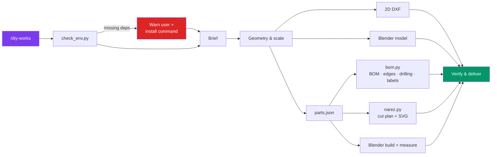

# DIY Works

From a design to fabrication. DIY Works turns a sketch, floor plan or manufacturer's technical PDF into a dimensioned 2D drawing, an editable Blender model, and the documents a workshop needs to build it: shop drawings, bill of materials, edge-banding and drilling schedules, and panel-saw cutting plans. It also designs and revises furnished interiors across CAD and Blender, compares layout variants, checks clearances of moving parts, and renders daylight or night views.

It works in both **Claude Code** and the **OpenAI Codex** agent, and in Czech or English (the browser guide switches automatically).

## What it Does

1. Runs a short guided brief, or starts right away from a direct request
2. Establishes geometry, scale and dimension sources (manufacturer / site / design decision / estimate)
3. Produces a 2D DXF drawing and/or an editable Blender model, as separate revisions
4. Resolves construction (parts, joints, back panel, hardware, drilling) and records it in one `parts.json`
5. Generates the BOM, edge banding, drilling schedule and part labels with `scripts/bom.py`
6. Plans sheet cuts with `scripts/narez.py` (kerf, trims, grain, edge build-up) and shows an SVG preview with the yield
7. Builds and measures the panel model in Blender with `scripts/blender/` (sizes, unapplied scale, clashes)
8. Checks door, drawer and chair clearances with `scripts/check_clearance.py`
9. Verifies the saved files and hands over the deliverables, listing what is still unverified



## Installation

```bash
npx skills add JakubKontra/skills --skill diy-works
```

The `skills` CLI installs it for Claude Code (`.claude/skills/diy-works`) or Codex (`~/.codex/skills/diy-works`). `agents/openai.yaml` provides the Codex display name and default prompt.

## Requirements

On first use, the skill runs `scripts/check_env.py`. If something is missing, it tells you what that blocks and gives the install command, and it installs nothing without your consent.

| Dependency | Needed for | Install |
| --- | --- | --- |
| Python 3.8+ | all helper scripts | python.org |
| `shapely` | clearance checks | `python3 -m pip install shapely` |
| `ezdxf` | DXF drawings and sheet layouts | `python3 -m pip install ezdxf` |
| Blender **or** a Blender MCP server | 3D models, renders | `brew install --cask blender` |
| ODA File Converter / libredwg | `.dwg` output (optional) | opendesign.com / `brew install libredwg` |
| LibreCAD | viewing DXF by eye (optional) | `brew install --cask librecad` |

`python3 scripts/check_env.py --install` creates `~/.venvs/diy-works` (override with `DIY_WORKS_VENV`) and installs `shapely` and `ezdxf` into it. This avoids the PEP 668 error on Homebrew and Debian Python. The check then finds the packages in the venv and tells the agent which interpreter to use.

## Quick Start

```bash
# Claude Code
/diy-works guide
/diy-works Draw a 1200×600 desk with a 3-drawer pedestal and give me a cut list for 18 mm birch ply

# Codex
$diy-works guide

# Scripts directly (from the skill directory)
python3 scripts/check_env.py --stage cutting
python3 scripts/bom.py examples/skrinka/parts.json out/
python3 scripts/narez.py out/narez-job.json out/sheets.svg --format svg
blender -b --python scripts/blender/build_panels.py -- examples/skrinka/parts.json out/model.blend
python3 scripts/check_clearance.py references/clearance-example.json --output clearance-report.json
```

See [`references/parts-json.md`](../diy-works/references/parts-json.md) for the project file format and [`examples/skrinka`](../diy-works/examples/skrinka/README.md) for a complete worked example (brief → parts.json → BOM, cut plan, model).

## Tests

```bash
cd diy-works && python3 -m unittest discover -s tests -v
```

The suite regenerates the worked example and compares it with `examples/skrinka/expected/`. It checks blank sizes, placement, overlaps, yield and SVG output, BOM validation, clearance statuses, `check_env` and, if Blender is installed, the build → measure round trip. The tests that need `shapely`, `ezdxf` or Blender are skipped when those are missing. CI (`.github/workflows/diy-works.yml`) runs on Python 3.8 and 3.13, both with only the standard library and with `shapely` and `ezdxf` installed.

Open `pruvodce.html` in a browser to prepare a brief offline. It exports a ZIP with `project-brief.txt` and your attachments, ready to drop into the chat.
